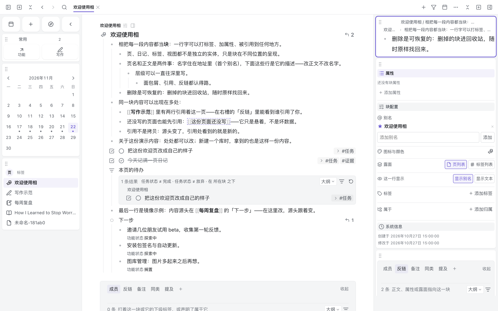
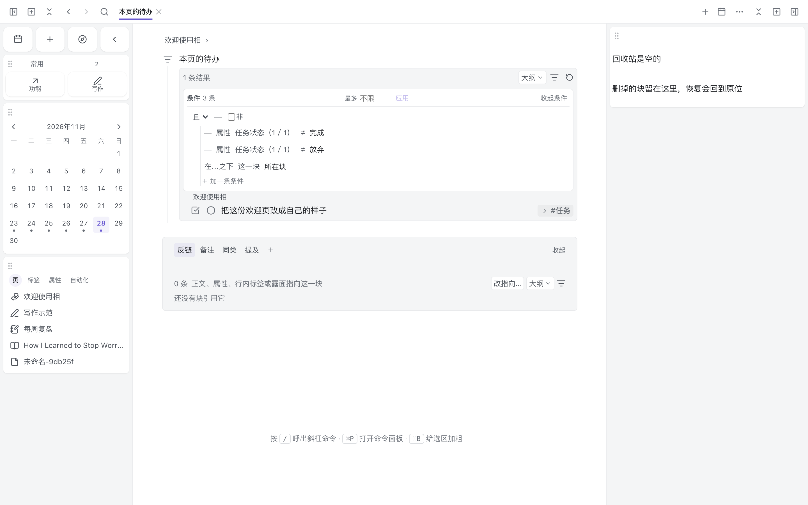

# Qua

A desktop outliner built for notes you'll write once and use again and again.

In Qua, every line you write is an independently actionable unit: tag it, give it properties, reference it from anywhere, drag it into a table or board to rearrange it, or mirror it onto multiple pages. Change it in one place and every place it appears updates in sync—content never gets locked inside the page where you wrote it.


---

## Join the community

Interested, have questions, or just want to chat? Join the QQ group "qua 双链笔记" (group number: 1044063116)—scan the QR code below to join.

<p align="center"></p>

---

## Quick start

**Try it online**: [qua.leay.net](https://qua.leay.net/) — open it and start writing, no installation needed. Your data stays in your own browser and is never uploaded to any server.

**macOS desktop app** (Apple Silicon): download the latest `.dmg` from [Releases](https://github.com/hqweay/qua/releases) and drag it into Applications. The installer is unsigned, so if macOS blocks it on first launch, right-click → Open.

**Windows desktop app** (x64): download the latest `.exe` installer from [Releases](https://github.com/hqweay/qua/releases) and double-click to install. The installer is unsigned, so if SmartScreen blocks it, click More info → Run anyway.

Both desktop apps use SQLite for storage and full-text search, with a more complete feature set than the browser version.

### About the beta

Qua is still in beta, so there are a few things worth spelling out up front:

- **Old data may not survive a version upgrade.** When the data format changes, we switch straight to the new format rather than writing a migration. Before a format change, the desktop app automatically leaves a `backups/` snapshot in the repo directory; to be extra safe, copy the entire repo directory ("Documents/Qua") before upgrading.
- **No import/export or cloud sync yet**—your data lives only on your own computer (or in your browser).
- The interface is available in Chinese and English; it follows your system language by default and can be switched in Settings.
- If you run into any problems, let us know in [Issues](https://github.com/hqweay/qua/issues).

---

## What makes it different

There are no rigid boundaries between pages, daily notes, tags, and views: a page can be a member of a tag, appear in three query results at once, and be referenced from another page—all of these are different uses of the same content, not three copies. A few concrete properties:

- **One block, many places.** Mirrored onto another page, pinned into a dock window, surfaced by a query—it's the same block everywhere, editable in place, with changes synced across all of them. Deletion is reversible too: deleted blocks go to the trash, and when restored their names, properties, and incoming references all come back exactly as they were.
- **Values are separate from categories.** Which tags a block "belongs to" and which field values are filled in on it are two different things: tags categorize, fields hold values. A tag can declare fields for its members, and each member fills them in and displays them independently.
- **Views are separate from data.** The same content can be seen from different angles—outline, table, board, calendar, and more. Switching views never rearranges your data, and changing a view never touches your content.
- **Names are separate from the body.** Page and tag names are addresses; the body is a description. Editing the body never changes the name; references always show the target's current name, so renaming a target updates every reference to it.

The model behind this design (why pages, daily notes, tags, and views can all be reduced to blocks) is written up in [`docs/模型-一切皆块.md`](docs/模型-一切皆块.md)—read it if you're curious; you don't need it to use Qua.



---

## What you can do

**Write**: the body is an editable tree of blocks. Bold, italic, highlight, inline code, text color, and background color all travel with the text; `[[引用]]`, `#提及`, `@提及`, external links, and images are self-contained inline units, so adding or deleting them never damages the characters nearby—deleting at the end of a line won't break a reference into stray characters, and deleting text won't turn a tag into a handful of `#` symbols. Pasting a bare URL automatically turns it into a link. Shortcuts step aside during IME composition, so Chinese input is never interrupted. Select a span of text to add a **note** (comments follow the text) or set a color from the selection bubble; cross-block selections under the same parent block can be deleted or edited in place (the first and last fragments merge into one block). With multiple blocks selected, you can drag them as a group, delete or indent them in bulk—`⌘⇧A` upgrades "the words on this line" into "these blocks".


**Capture**: quick notes land in today's daily note; `⌘T` brings you back to today any time, `⌘⇧R` reviews the last three days (`⌘⌥⇧R` the last seven); `@` mentions pages and blocks, creating a page on the spot if no page with that name exists; every daily note and page can be given an **icon and color**, so you can tell at a glance what's what. The daily-note host also carries a few built-in sections: references, created today, notes, and mentions.

**Organize**: tags are hierarchical, and any block can have multiple "belongs to" relations—dragging it into the left-hand membership tree adds a relation, it doesn't move the block; tag order can be adjusted by dragging too. Declare **properties** on a tag, then write values on each block itself and edit them in place in the inspector card on the right. There are seven property types: text, number, date, checkbox, single select, reference, and attachment. Text can carry formatting (link / email / phone), and dates can be a date or a date-time; text, number, single select, reference, and attachment can all store **multiple values**, displayed as a row of chips. A reference property can narrow its candidate pool (under certain tags, a specified set of blocks, or the results of a query) and display as a chip or an editable inline reference; an attachment value can be an external link or a local image imported into the library. Mark a single-select field as "task status" and checking it completes the task, using the same interactions and queries as built-in to-dos.

**View**: the direct children of a page (or of any block) can be presented in seven views: outline, table, outline-table, cards (a gallery when ungrouped, a board when grouped by a property, with a toggle to "use the body's first image as the cover"), calendar, mind map, and tabs; query results can switch among four views: outline, table, cards, and calendar. Switching views never rearranges data, and changing a view never touches your content. Each view has an "Options" button in its header that gathers sorting, filtering, grouping, and display into one panel: tables let you drag column widths, cards let you adjust covers, and a grouped column header is that property's value. To look at a batch of blocks at once, use a query to circle up the members: conditions form a nestable condition tree, with each line reading like a sentence; "unfilled tasks" and "not tasks" are clearly distinguished; you can also ask existence questions like "has children", "has body", "has tag", or write relative dates like "before today" or "last seven days".



**Find**: full-text search on the desktop runs on a SQLite full-text index (Chinese word segmentation + pinyin); `⌘K` finds blocks by keyword, with hits you can preview and edit in place, and the `⌘P` command palette runs every command—no need to memorize shortcuts. The search surface can live permanently as a dock card or a center tab, and a set of search results can be "promoted into a query block" right where it is, becoming a view that refreshes itself. All keybindings can be changed in Settings.

---

## The shape language in the body

Several kinds of atoms can live side by side in a single body of text. The shape itself is the relationship:

| What you write | What it is | How to recognize it |
|---|---|---|
| `[[页名]]` | Page reference | Bold + double brackets; click to jump straight there, `Shift+点击` opens a window in the dock |
| `#名字` | Inline **mention** | Takes a slot in the body; it won't tag the block for you or make it a member of that tag |
| End-of-line chip | Tag **membership** | Determined by the block's own tags; deleting text in the body won't remove it—to remove it, do so explicitly in the inspector card |
| Triangle (to the left of a chip) | This tag has fields | Click to fill values in place; tags without fields don't get a triangle drawn |
| `@名字` | Mention an addressable block | Once you name a regular block, it can be `@`-mentioned just like a page |
| Image / external link | Inline atom | Images are content-addressed, so pasting the same one twice stores only one copy; clicking an external link hands it to your system browser |

A tag says "who this content belongs to"; a field value says "what this content carries itself"—once the two are separate, deleting text, renaming, and moving never damage each other.

---

## Common keyboard shortcuts

| Key | Action |
|---|---|
| `Enter` / `⇧Enter` | Create a sibling / child block at the cursor |
| `Tab` / `⇧Tab` | Indent / outdent |
| `⌘⏎` | Toggle a to-do complete |
| `⌘B` / `⌘I` / `⌘E` / `` ⌘` `` | Bold / italic / highlight / inline code (select text first) |
| `⌘⇧K` / `@` / `#` | Insert a reference / mention a page or block / mention a tag |
| `⌘.` | Fold / unfold the current block |
| `⌘Z` / `⌘⇧Z` | Undo / redo (when the editor is focused) |
| `⌘⇧A` | Select this line → these blocks |
| `⌘P` | Command palette |
| `⌘K` | Global search (always available; insert a link from the slash menu or block menu) |
| `⌘T` / `⌘⇧R` | Go to today's daily note / review the last three days |
| `⌘⇧L` / `⌘,` | Toggle theme / Settings |
| `⌘⇧?` | Keymap (each command's shortcut and when it applies) |

Mouse: the block handle stays at the left of each line and turns into a drag grip on hover; left-click to focus, right-click for the menu, drag to reorder; `Shift+点击` opens a window in the dock, `⌥+点击` shows property details in place. Rows in record views (table / cards / list / calendar) also open the same block menu on right-click—the menu opens for the specific block you clicked, and deletions and copies both go through undo; only actions that make sense for a block appear (editor-dependent ones like indent or fold don't).

---

## Where your data lives

- **Desktop**: each repo is a directory under "Documents/Qua" (`repos/<id>/`), with content stored in `qua.db` (SQLite) and images saved by content hash under `assets/`. Every edit writes only the parts that changed, so large repos stay fast. `Qua/app.json` keeps the repo list, and you can also open any external directory as a repo. Before a data-format change, a full snapshot of the repo is automatically left in `backups/`.
- **Browser**: the body and structure live in the browser's localStorage, and inline images in IndexedDB; plan a backup before switching devices or clearing browser data. Search in the web version is a local scan, with no word segmentation or pinyin.
- **Deletion**: deletes are soft deletes and can be restored with one click from the trash; only emptying the trash removes them for good.

---

## Current limitations

- No import/export (Markdown and other formats aren't supported yet) and no cloud sync.
- The desktop apps are unsigned (on macOS, right-click → Open on first launch) and never replace themselves:
  the app checks for a new version every 5 hours and says so in the app menu; installing it is still up to you. Back up your repo directory before upgrading.
- The edges of cross-block collapsing aren't fully covered yet: when a selection crosses parent blocks, or when the first block is a section root (the first level of a page's or daily note's body), deleting or replacing that cross-block selection isn't supported yet.
- Inline assets are limited to images for now; attachments in properties can be any file or an external link.
- The interface is available in Chinese and English; it follows your system language by default and can be switched in Settings. There's no mobile app, collaboration, or plugin system, and none of these are near-term goals.

---

## Feedback

Found a bug, strange data behavior, or something that just feels off? Open an [Issue](https://github.com/hqweay/qua/issues). A single sentence covering "which screen, what you did, what you expected, what actually happened" is already a useful report; for data problems, describe the steps you took—no need to attach the repo file (it contains your content).

---

## Contributing

```bash
pnpm install
pnpm dev            # start vite + electron together
pnpm dev:web        # browser only → http://127.0.0.1:5180/
pnpm gate           # full gate: static assertions + unit tests + build + smoke + real Electron
pnpm build:mac      # produce .app and .dmg (release/ directory)
```

You'll need Node 26.x and pnpm 11.x. Before you start, read [`AGENTS.md`](AGENTS.md) (engineering discipline), [`CONTRIBUTING.md`](CONTRIBUTING.md) (process), and [`docs/ROADMAP.md`](docs/ROADMAP.md) (what's next).

The architecture has five layers: `core ← view ← ui ← app ← host`; the model layer has zero DOM, commands never touch page elements, and structural constraints are enforced statically by `pnpm arch:check`. Visualization and more docs: [`https://qua.leay.net/arch.html`](https://qua.leay.net/arch.html) · [`docs/ARCH-断言.md`](docs/ARCH-断言.md) · [`docs/ELECTRON-备忘.md`](docs/ELECTRON-备忘.md).

---

## License

[AGPL-3.0](LICENSE) © 2026 hqweay
