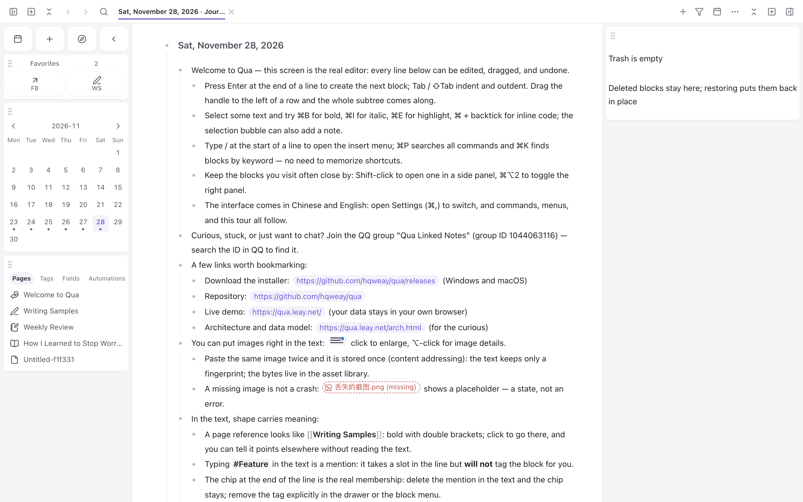
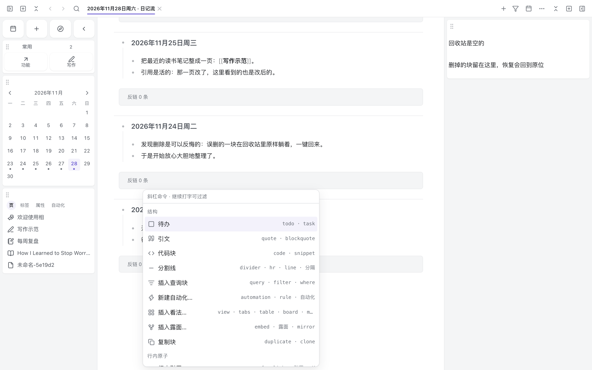

# Qua

A desktop outliner built for notes you'll write once and use again and again.

**[中文 README](README.md)** · The interface comes in Chinese and English; it follows your system language by default and can be switched in Settings.

In Qua, every line you write is an independently actionable unit: tag it, give it properties, reference it from anywhere, drag it into a table or board to rearrange it, or mirror it onto multiple pages. Change it in one place and every place it appears updates in sync—content never gets locked inside the page where you wrote it.

Properties live on the block too: focus a block and a property bar stands up under it, with the empty fields folded into one line; who it is (name, icon, lists) and whom it belongs to live in the properties drawer. Both entries edit the same values, so you never have to hunt for a side panel first.



---

## Join the community

Interested, have questions, or just want to chat? Join the QQ group "qua 双链笔记" (group number: 1044063116)—scan the QR code below to join.

<p align="center"></p>

---

## Quick start

**Try it online**: [qua.leay.net](https://qua.leay.net/) — open it and start writing, no installation needed. Your data stays in your own browser and is never uploaded to any server.

**macOS desktop app** (Apple Silicon): download the latest `.dmg` from [Releases](https://github.com/hqweay/qua/releases) and drag it into Applications. The installer is unsigned, so if macOS blocks it on first launch, right-click → Open.

**Windows desktop app** (x64): download the latest `.exe` installer from [Releases](https://github.com/hqweay/qua/releases) and double-click to install. The installer is unsigned, so if SmartScreen blocks it, click More info → Run anyway.

Both desktop apps use SQLite for storage and full-text search, with a more complete feature set than the browser version. After installing **0.1.0-beta.9**, you can check for updates from the "Qua" menu and download future installers in-app (the final install step is still manual).

### About the beta

Qua is still in beta, so there are a few things worth spelling out up front:

- **Old data may not survive a version upgrade.** When the data format changes, we switch straight to the new format rather than writing a migration. Before a format change, the desktop app automatically leaves a `backups/` snapshot in the repo directory; to be extra safe, copy the entire repo directory ("Documents/Qua") before upgrading.
- **No file import/export or cloud sync yet**—your data lives only on your own computer (or in your browser). Pasting Markdown already works (headings, lists, quotes, and fenced code become blocks), but that is the editor's input surface, not file import.
- **The interface comes in Chinese and English**, follows your system language by default, and can be switched in Settings.
- The app checks for a new version every 5 hours and mentions it in the "Qua" menu; installing it is still up to you.
- If you run into any problems, let us know in [Issues](https://github.com/hqweay/qua/issues).

---

## What makes it different

There are no rigid boundaries between pages, daily notes, tags, and views: a page can be a member of a tag, appear in three query results at once, and be referenced from another page—all of these are different uses of the same content, not three copies. A few concrete properties:

- **One block, many places.** Mirrored onto another page, pinned into a dock window, surfaced by a query—it's the same block everywhere, editable in place, with changes synced across all of them. Deletion is reversible too: deleted blocks go to the trash, and when restored their names, properties, and incoming references all come back exactly as they were.
- **Values are separate from categories.** Which tags a block "belongs to" and which field values are filled in on it are two different things: tags categorize, fields hold values. A tag can declare fields for its members, and each member fills them in and displays them independently.
- **Views are separate from data.** The same content can be seen from different angles—outline, table, board, calendar, mind map, and more. Switching views never rearranges your data, and changing a view never touches your content.
- **Names are separate from the body.** Page and tag names are addresses; the body is a description. Editing the body never changes the name; references always show the target's current name, so renaming a target updates every reference to it.
- **A library is just a folder.** A library is an ordinary directory (`library.json` + `qua.db` + `assets/`). No account, no server; copying the whole folder is a complete backup.

The model behind this design (why pages, daily notes, tags, and views can all be reduced to blocks) is written up in [`docs/模型-一切皆块.md`](docs/模型-一切皆块.md)—read it if you're curious; you don't need it to use Qua.

---

## One chunk of content, several readings

The outline is the default shape, not the only one. The direct children of a page (or of any block) can be read another way, and the configuration lives on that block itself: **how a block is read is its configuration, not its type.**

- **Table**: children become rows, properties become columns, and you edit the body right in the cell.
- **Outline table**: the header row is the direct children, and one column is that child's kids—indentation turned sideways.
- **Cards**: a gallery when ungrouped, a board when grouped by a property, with an optional cover taken from the body's first image.
- **Calendar**: blocks with dates land on their day.
- **Mind map**: the root sits in the middle and branches spread to both sides. A node shows the block's own title (up to three lines; hover for the full text, click to jump there). When the map is wider than the pane, drag horizontally, or switch to the wide layout to see all of it.
- **Tabs**: one child at a time.
- **Outline**: switch back and the child rows return exactly as they were—every reading renders the same set of children.

Switching views never rearranges content, and changing a view never touches data. The same block stays visible in the body, in a dock window, and in the mount area—same content, same configuration. A dock window has the same anatomy as the center: the content root is followed by the same query and backlink mount sections, not a body-only snapshot.


---

## What you can do

**Write**: the body is an editable tree of blocks. Bold, italic, highlight, inline code, text color, and background color all travel with the text; `[[references]]`, `#tags`, `@names`, external links, and images are self-contained inline units, so adding or deleting them never damages the characters nearby—deleting at the end of a line won't break a reference into stray characters, and deleting text won't turn a tag into a handful of `#` symbols. Shortcuts step aside during IME composition, so Chinese input is never interrupted. Select a span of text to add a **note** (comments follow the text) or set a color from the selection bubble; cross-block selections under the same parent block can be deleted or edited directly (the first and last paragraphs merge into one). Select several blocks to drag them as a group, delete them in bulk, or indent them—`⌘⇧A` upgrades "this line's text" to "these blocks". At the start of the text press `↑` again, at the end press `↓`, and the neighbouring block gets selected; keep going and objects (queries, code, callout headers, mirrors) are selected one by one, while a plain text row hands the caret back so you can keep typing.

**Callouts** are line-by-line containers: the header only shows the tone, and clicking it switches among seven tones (quote / info / warning / error / tip / important / note). Every line is its own block with its own id and can be referenced separately; indent one level and it becomes an ordinary block, while the tone's rail runs through the whole group. The tone is a **value**, not a type—a query can filter "callout type = warning" in one condition. The types themselves are editable: create one from the header menu, give it a name, an icon and a color; the built-in "quote" is the one you can't delete. The slash menu (/quote), the block menu ("Turn into ▸ Quote"), and pasting Markdown's `>` all produce the same shape.

**Code blocks** show their language in a badge on the title row; click the badge to switch (59 languages have real syntax and are searchable). The editing surface is CodeMirror: syntax highlighting, auto-indent, bracket matching, in-block search (`⌘F`), multiple selections, and IME, with undo shared with the rest of the app. The code lives in the block's body and the title is its name; the body folds on its own while the title and language badge stay put. Code blocks hold no bold, references, or tags—it is code, not rich text.

**Paste Markdown** is an explicit command (`⌘P` → "Paste Markdown", or the block menu): headings become a tree of parent and child blocks, lists become indented blocks, `>` becomes a callout, fenced code becomes a code block, and bold / italic / strikethrough / links / inline code land as usual. Syntax the model can't hold yet—tables, task lists—is kept verbatim with a one-line notice: nothing is silently swallowed and nothing pretends to have converted. The default `⌘V` is untouched.

**Body folding** is a second fold position: the button on the row head collapses only the body while the children stay; the triangle on the left collapses the whole subtree. Code blocks and query blocks have bodies, and so can ordinary blocks and field definitions; the two folds are independent.



**Capture**: quick notes land in today's daily note; `⌘T` brings you back to today any time, `⌘⇧R` reviews the last three days (`⌘⌥⇧R` the last seven); `@` mentions pages and blocks, creating a page on the spot if no page with that name exists; every daily note and page can be given an **icon and color**, so you can tell at a glance what's what. The daily-note host also carries a few built-in sections: references, created today, notes, and mentions.

**Organize**: a block can belong to several tags at once, and tags themselves can be hierarchical. The **Directory** card in the left panel spreads the library's structural objects across four faces—pages, tags, property definitions, automations. The first two lay out the membership tree: dragging a block in adds a membership relation, it doesn't move the block. The last two are flat lists by identity and read-only. Properties are declared on tags, written on each block itself: focus a block and a property bar stands up under it, and the small icons beside the block marker, that bar, and the properties drawer all edit the same values. There are seven property types: text, number, date, switch, option, reference, and attachment. Text can carry formatting (link / email / phone), and dates can be a date or a date-time; text, number, option, reference, and attachment values can hold **multiple values**, shown as a row of chips. Option records carry their own icon and color, and the value icon beside the block marker takes that color. A reference property can restrict its candidates (blocks under certain tags, a hand-picked set, or a query's results) and renders as a chip or an inline reference you can edit in place; an attachment value can be an external link or a local image imported into the library. Mark an option field as "task status" and ticking it completes the block, sharing the same interactions and queries as built-in to-dos.

When references point at the wrong target, you don't have to fix them one by one: the header of the backlinks bar and of a tag's members bar both offer "**Retarget…**"—pick a new target once and that whole batch of references moves over, undoable in one step.

Deletion has a single entry point: a block, a day, a page, a tag, a field definition all show the same "Delete" row in the menu. The confirmation only spells out what goes with it; deleted things go to the trash, and restoring brings back names, properties, and relations exactly as they were.

**Automation**: an automation is a block that reads "**if … then …**". Triggers can be manual, a property change, a tag being added or removed, or a new child under a block (which can be limited to direct children, so adding a note to a grandchild won't fire the rule); the "if" uses the same condition language as queries to circle up targets; the "then" is a small closed set of built-in actions: set/clear a property, add/remove a tag, insert a child, move. A manual run acts on the block you selected; to run over a batch, use the "if" to define the range. Manual automations are available from "My automations…" in the block menu, and the ones you use most can be pinned to the top of the command palette. Each run is one transaction—a failure rolls the whole batch back, and one undo reverses the run. Disabled/active is part of the definition (it travels with the library), so a rule you got from somewhere else never starts firing on its own.

**View**: the direct children of a page (or of any block) can be presented in seven views: outline, table, outline-table, cards (a gallery when ungrouped, a board when grouped by a property, with a toggle to "use the body's first image as the cover"), calendar, mind map, and tabs; query results can switch among four views: outline, table, cards, and calendar. Switching views never rearranges data, and changing a view never touches your content. Each view has an "Options" button in its header that gathers sorting, filtering, grouping, and display into one panel: tables let you drag column widths, cards let you adjust covers, and a grouped column header is that property's value. To look at a batch of blocks at once, use a query to circle up the members: conditions form a nestable tree, one condition per line reading like a sentence, and "unfilled tasks" is clearly distinct from "not a task"; you can also ask existence questions like "has children", "has a body", "has tags", or write relative dates like "before today" or "last seven days".


**Find**: full-text search on the desktop runs on a SQLite full-text index (Chinese word segmentation + pinyin); `⌘K` finds blocks by keyword, with hits you can preview and edit in place, and the `⌘P` command palette runs every command—no need to memorize shortcuts. The search surface can live permanently as a dock card or a center tab, and a set of search results can be "promoted into a query block" right where it is, becoming a view that refreshes itself. Keybindings for command-palette commands can all be changed in Settings—some follow this machine, others follow this workspace.

---

## The shape language in the body

Several kinds of atoms can live inside one block's text. The shape itself carries the relation:

| What you type | What it is | How to read it |
|---|---|---|
| `[[Page name]]` | page reference | bold with double brackets; click to go there, `Shift+click` opens it in a dock window |
| `#Name` | inline tag / inline instance | takes one slot in the text; points at a tag or a record—it does **not** tag the block for you |
| the chip at line end | tag **membership** | decided by the block's own tags; deleting text doesn't remove it—remove it explicitly from the block menu or the property bar |
| the triangle (left of the chip) | this tag has fields | click to fill values in place; tags without fields don't get a triangle |
| `@Name` | reference to a page or a named block | once an ordinary block has a name, `@` finds it just like a page |
| image / external link | inline atom | images are content-addressed, so pasting twice stores once; a link opens in your system browser |

Tags answer "whose content is this"; field values answer "what does this content carry"—keeping them apart means deleting text, renaming, or moving never damages the other.

---

## Common keyboard shortcuts

| Key | What it does |
|---|---|
| `Enter` / `⇧Enter` | create the next sibling / a child at the insertion point |
| `Tab` / `⇧Tab` | indent / outdent |
| `⌥Enter` (`Alt+Enter` on Windows) | create a sibling at the current block's parent level |
| `⌘⇧N` | new page (asks for a name first; an existing page with that name opens instead of creating a duplicate) |
| `⌘⏎` | toggle to-do completion |
| `⌘B` / `⌘I` / `⌘E` / `` ⌘` `` | bold / italic / highlight / inline code (select text first) |
| `⌘⇧K` / `@` / `#` | insert an inline reference / reference a page or block / insert an inline tag |
| `⌘.` | fold / unfold the current block's children |
| `/` | insert menu at line start: to-do, callout, code block, query, image… |
| `⌘F` | inside a code block = in-block search; elsewhere = app search |
| `⌘Z` / `⌘⇧Z` | undo / redo (while the editor has focus) |
| `⌘⇧A` | select this line → these blocks |
| `↑` / `↓` (at the edges of the text) | select the previous / next block; objects are selected one by one, plain text rows hand the caret back |
| `⌘P` | command palette (also holds actions without a keybinding; palette commands can all be assigned keys in Settings) |
| `⌘K` | global search (always available; inserting a link lives in the slash menu and block menu) |
| `⌘T` / `⌘⇧R` | back to today's journal / review the last three days |
| `⌘⌥1` / `⌘⌥2` | toggle the left / right dock |
| `⌘⇧L` / `⌘,` | toggle theme / Settings (the interface language lives here too) |
| `⌘⇧?` | binding table (keymap / menu / slash / selection; commands without bindings are in `⌘P`) |

Mouse: the block handle sits to the left of each row and turns into a drag grip on hover; left-click focuses, right-click opens the menu, drag reorders. `Shift+click` opens a window in the side dock, `⌥+click` shows property details in place, and `⌘⌥+click` (`Ctrl+Alt+click` on Windows/Linux) opens the block in its parent and scrolls to it. Rows in record views (table / cards / list / calendar) open the same block menu on right-click—the menu opens for the block you clicked, deletion and copying are undoable, and only actions that make sense for a block appear (indent/fold and other editor-dependent ones don't).

Callout behavior lives in the header: click the tone badge to switch variants, and the same menu creates and manages your own types. Code-block behavior lives in the title row: click the language badge to switch languages; the row-head button folds only the body.

---

## Where your data lives

- **Desktop**: each library is a directory under "Documents/Qua" (`repos/<id>/`); content lives in `qua.db` (SQLite), and images are stored by content hash under `assets/`. Every edit writes only what changed, so a big library doesn't get slower. `Qua/app.json` records the library list, and you can open any external directory as a library. Before a data-format change, the app leaves a full-library snapshot in `backups/`.
- **Browser**: text and structure live in the browser's localStorage, and inline images in IndexedDB; think about backups before switching devices or clearing browser data. Search in the web version is a local scan, without word segmentation or pinyin.
- **Deletion**: deletes are soft; the trash restores with one click, and only emptying the trash makes it final.

---

## Current limitations

- No file import/export (Markdown paste is the editor's input surface, not file import) and no cloud sync.
- The desktop app is unsigned (on macOS, right-click → Open the first time). It checks for a new version every 5 hours and mentions it in the "Qua" menu; from 0.1.0-beta.9 onward it can download the installer in-app, but installing it (and the final macOS drag step) is still up to you. Back up the library directory before upgrading.
- Cross-block merging has unfinished edges: a cross-block selection that spans different parents, or whose first block is a section root (the first level of a page or daily note), can't be deleted or replaced yet.
- Inline assets and attachments currently accept images only; an attachment value can also be an external link.
- Automation actions are a small closed set of built-in operations—no scripting. Richer workflows will have to wait for a plugin system.
- Code blocks are an editor, not an IDE: no completion, diagnostics, formatting, or language services, and no rich text inside code.
- A callout's header is a tone badge, not an editable title; to name one, put the name in one of its lines.
- The mind map reads child blocks only (query hits are a flat batch with no root), and does not fold or drag yet.
- The interface is available in Chinese and English (system language by default, switchable in Settings); there is no mobile app, collaboration, or plugin system, and none of those are near-term goals.

---

## Feedback

Bugs, data oddities, or anything that feels off—open an
[Issue](https://github.com/hqweay/qua/issues).
One sentence covering "which screen, what you did, what you expected, what actually happened" is a very useful report; for data problems, describe what you did—no need to attach the library file (it contains your content).

---

## Contributing

```bash
pnpm install
pnpm dev            # vite + electron together
pnpm dev:web        # browser only → http://127.0.0.1:5180/
pnpm gate           # full gate: static checks + unit tests + build + smoke + real Electron
pnpm build:mac      # .app and .dmg (release/ directory)
```

Node 26.x and pnpm 11.x are required. Before touching code, read [`AGENTS.md`](AGENTS.md) (engineering rules),
[`CONTRIBUTING.md`](CONTRIBUTING.md) (workflow), and [`docs/ROADMAP.md`](docs/ROADMAP.md) (what's next).

The architecture has five layers: `core ← view ← ui ← app ← host`. The model layer has zero DOM, commands never touch page elements, and the structural constraints are enforced statically by `pnpm arch:check`. Visualization and more docs:
[`https://qua.leay.net/arch.html`](https://qua.leay.net/arch.html) ·
[`docs/ARCH-断言.md`](docs/ARCH-断言.md) · [`docs/ELECTRON-备忘.md`](docs/ELECTRON-备忘.md).

---

## License

[AGPL-3.0](LICENSE) © 2026 hqweay
