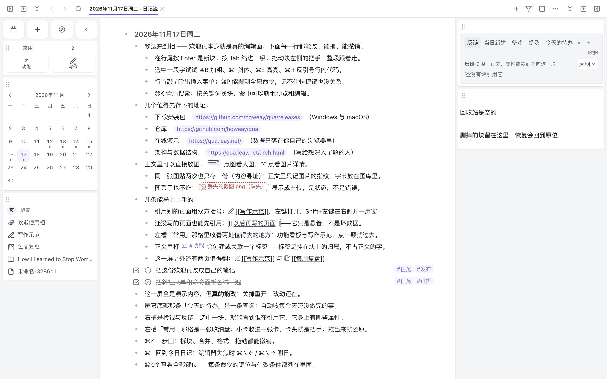
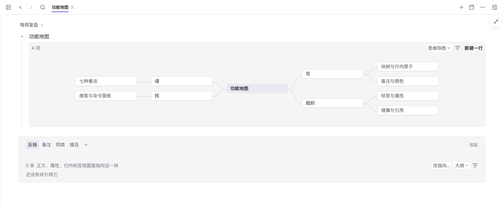
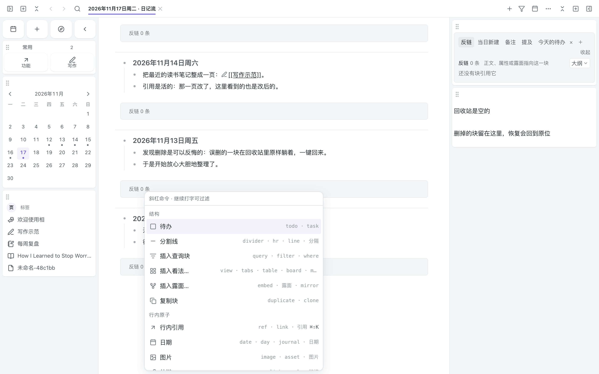
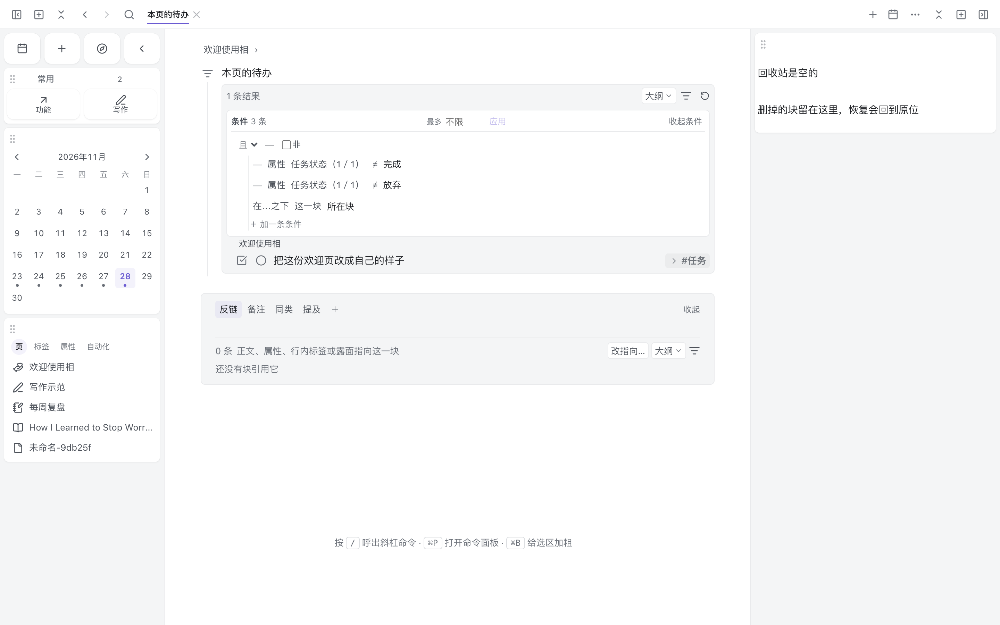

# 相（Qua）

一款桌面大纲笔记，为「写下来之后还要反复使用」而设计。

**[English README](README.en.md)** · 界面支持中文与英文，默认跟随系统语言，可在设置里切换。

在相里，你写的每一行都是一个可独立操作的单位：可以打标签、加属性、被引用到任何地方、
拖进表格或看板重新排列、镜像到多个页面。改动任何一处，所有出现它的地方同步更新——
内容不会被锁死在写下它的那个页面里。



---

## 加群交流

感兴趣、有疑问，或想找人聊聊？欢迎加入 QQ 群「qua 双链笔记」（群号：1044063116）——扫码即可入群。

<p align="center"></p>

---

## 快速开始

**在线体验**：[qua.leay.net](https://qua.leay.net/) —— 打开就能写，不用安装。
数据保存在你自己的浏览器里，不会上传到任何服务器。

**macOS 桌面版**（Apple Silicon）：到 [Releases](https://github.com/hqweay/qua/releases)
下载最新的 `.dmg`，拖进「应用程序」即可。安装包没有签名，首次打开若被系统拦下，右键 →「打开」。

**Windows 桌面版**（x64）：到 [Releases](https://github.com/hqweay/qua/releases)
下载最新的 `.exe` 安装程序，双击安装即可。安装包没有签名，SmartScreen 若拦下，
点「更多信息」→「仍要运行」。

两个桌面版都是 SQLite 存储、全文搜索，功能比浏览器版完整。安装过 **0.1.0-beta.9** 之后，
后续版本可以在「相」菜单里点「检查更新…」直接下载安装包（最后一步安装仍需手动）。

### 关于 beta

相还处在 beta 阶段，有几件事想先说清楚：

- **升级版本时旧数据可能无法保留。** 数据格式变化时我们选择直接换新格式，而不是写迁移。
  桌面版在换格式之前会在库目录里自动留一份 `backups/` 快照；想更稳妥，升级前把整个库目录
  （「文稿/Qua」）拷一份。
- **暂时没有文件导入导出和云同步**，数据只在你自己的电脑（或浏览器）里。粘贴 Markdown
  已经可用（标题、列表、引述、代码围栏会变成块），但那是编辑器的输入面，不是文件导入。
- **界面有中文和英文两套**，默认跟随系统语言，可在设置里切换。
- 应用每 5 小时查一次新版；有更新会在「相」菜单里提示，点开可把安装包下载到「下载」并打开
  （进度显示在 Dock／任务栏）。macOS 未签名，最后一步安装仍需手动。
- 有任何问题都欢迎到 [Issues](https://github.com/hqweay/qua/issues) 告诉我们。

---

## 它特别在哪

页、日记、标签、视图之间没有僵硬的边界：一篇页可以同时是某个标签的成员、
同时出现在三个查询结果里、被引用进另一篇页——这些都是同一份内容的不同用法，
不是三份拷贝。几个具体的性质：

- **一块内容，多处出现。** 镜像到另一页、钉进侧槽窗口、被查询捞出来——都是同一块，
  在哪里都能直接编辑，改动处处同步。删除也是可恢复的：删掉的块进回收站，
  恢复后名字、属性、被谁引用的关系都原样回来。
- **值与分类分开。** 一块「属于」哪些标签，和它身上填了哪些字段的值是两件事：
  标签给归类，字段给值。同一个标签可以给成员声明字段，成员各自填、各自显示。
- **看法与数据分离。** 同一批内容可以从大纲、表格、看板、日历、思维导图等不同角度去看，
  换看法不重排数据，改看法也不动你的内容。
- **名字和正文分开。** 页名、标签名是地址，正文是描述。改正文不会改名字；
  引用永远显示目标当前的名字，目标改名，所有引用跟着变。
- **一个库就是一个文件夹。** 库是一个普通目录（`library.json` ＋ `qua.db` ＋ `assets/`），
  没有账号，也没有服务器；拷贝整个目录就是一份完整备份。

这个设计背后的模型（页、日记、标签、视图为何都能还原成块）写在
[`docs/模型-一切皆块.md`](docs/模型-一切皆块.md)，感兴趣再读，不读不影响使用。

---

## 同一份内容，几种读法

大纲是默认的样子，但不是唯一的样子。页（或任何一块）的直接子块都能换一种读法，
配置挂在那一块自己身上：**一块怎么读是它的配置，不是它的类型**。

- **表格**：子块当行，属性当列，格子里直接改正文。
- **大纲表格**：表头是直接子块，一列＝那个子块的孩子——把缩进翻译成横向。
- **卡片**：不分组是画廊，按属性分组就是看板，可以取正文首图当封面。
- **日历**：有日期的块按天落位。
- **思维导图**：根在中间，分支向两侧铺开。节点里是块自己的标题（长句最多三行，
  悬停看全文，点开就跳到那块）；图比屏幕宽时横向拖动，也可以切到宽屏档位看全图。
- **页签**：一次只看一个子块。
- **大纲**：切回来，子块行原样回来——所有看法读的都是同一批子块。

换看法不重排内容，改看法也不动数据；同一块在正文、侧槽窗口、挂载区里同时可见，
看到的是同一份内容与同一份配置。侧槽窗口与中心同构：正文根块之后同样带着查询、
反链这些挂载栏，不是一张只有正文的截图。



---

## 能做什么

**写**：正文是一棵可编辑的块树。加粗、斜体、高亮、行内代码、文字与背景色随文字走；
`[[引用]]`、`#标签名`、`@名字`、外链、图片都是完整的行内单元，增删不会伤到旁边的字——
行尾删除不会把引用拆成几行字，删字也不会把标签变成几个 `#`。
输入法组合期间快捷键自动让路，中文输入不受干扰。
选中一段字，还能从划选气泡里写**备注**（批注跟字走）或设置颜色；
同一父块下的跨块选区可以直接删改（首尾两段拼成一块）。选中多块可以整组拖动、
批量删除与缩进——`⌘⇧A` 把「这一行的字」升级成「这些块」。

**引述**是一行一行的容器：抬头只画语气，点开在七种语气之间切换
（引述／信息／警告／错误／提示／重要／注意）。每一行都是独立的块，有自己的 id，
可以单独被引用；缩进一层就是普通块，语气竖线贯穿整组。语气是**值**不是类型——
查询条件里能按「引述类型」一次筛出所有警告。斜杠 `/引文`、块菜单「转为 ▸ 引文」、
粘贴 Markdown 的 `>` 三条入口造的是同一个形状。

**代码块**把语言写在标题行的徽章上，点徽章就能换（59 门有真实语法，可搜）。
编辑面是 CodeMirror：语法高亮、自动缩进、括号匹配、行内搜索（`⌘F`）、多选区与 IME，
撤销与应用其它部分共用一套历史。代码文档住块的身体，标题是它的名字；
身体可以单独折起来，标题与语言徽章留在原地。代码里不放加粗、引用与标签——
它是代码，不是富文本。

**粘贴 Markdown** 是一次显式命令（`⌘P` 搜「粘贴 Markdown」，或块菜单）：
标题按层级变成一组父块／子块，列表变成缩进的块，引述变成引述容器，围栏代码变成代码块，
粗体／斜体／删除线／链接／行内代码照常落地。表格、任务列表这类模型暂时装不下的语法
按原文保留，并给一句提示——不静默吞掉，也不假装转换成功。默认 `⌘V` 不动。

**身体折叠**是第二个折叠位：行头那颗按钮只收身体，子块还在；左侧三角才收整棵子树。
代码块、查询块有身体，普通块也能有；两者互不牵连。



**记**：随手记录落进今日日记，`⌘T` 随时回今天，`⌘⇧R` 复盘最近三天（`⌘⌥⇧R` 是最近七天）；
`@` 提及页与块，没有同名页时当场建页；每条日记、每一页都能配**图标与颜色**，
扫一眼就知道哪条是什么。日记宿主上还挂着几条内置栏：引用、当日新建、备注、提及。

**组织**：一个块可以同时属于多个标签，标签自己也能有层级。左槽的**目录**把库里的
结构对象摊成四面：页、标签、属性定义、自动化——前两面按归属边摊成树，把块拖进去
就是加一条归属，不是搬家；后两面按身份平铺，只读。属性声明在标签上，值写在每块
自己身上，在右侧检视卡里就地编辑。属性有七种：文本、数字、日期、开关、选项、引用、附件。
文本可以带格式（链接／邮箱／电话），日期可以是日期或日期时间；
文本、数字、选项、引用、附件都能存**多个值**，显示成一行 chips。
引用类型的属性可以限定候选范围（某些标签下、指定几个块、或一个查询的结果），
显示成 chip 或就地可编辑的行内引用；附件类型的值可以贴外链，也可以选本地图片入库。
把一个选项字段标为「任务状态」后，勾选即完成，和内置待办走同一套交互与查询。

引用指错了目标也不用逐处改：反链栏、标签的成员栏抬头都有「**改指向…**」，
选一次就把那一批引用整片换过去，一步撤销。

删除只有一入口：块、这一天、页、标签、字段定义在菜单里都是同一行「删除」，
确认框只说清连带代价；删掉的进回收站，恢复后名字、属性、关系原样回来。

**自动化**：一条自动化就是一块「**如果……就……**」。触发可以手动运行、某个属性变化、
被打上或摘掉某个标签、或在某个块下新建子块（可以选只看直接子块，给子块挂备注不会误伤）；
「如果」用和查询同一门条件语言圈目标；「就」是一小组内置动作：设／清属性、挂／摘标签、插子块、移动。
手动运行只作用于选中的那一块；要让满足条件的一批块一起跑，用「如果」圈范围。
手动自动化能从块菜单「我的自动化…」直接找到，常用的几条可以固定到命令面板顶部。
整条运行是一笔事务——失败整批回滚，跑完一步撤销。停用是定义的一部分（随库同步），从别处拿来的规则不会自己生效。

**看**：一页（或任何一块）的直接子块，都能用七种看法呈现：大纲、表格、大纲表格、
卡片（不分组是画廊，按属性分组就是看板，可开关「取正文首图作封面」）、日历、思维导图、页签；
查询结果则能在四种看法间切换：大纲、表格、卡片、日历。换看法不重排数据，改看法也不动你的内容。
每种看法的抬头有一颗「选项」，把排序、筛选、分组、显示四件事收在一个面板里：
表格能拖列宽、卡片能调封面，分组的列头就是那个属性的值。
要批量看一拨块，就用查询圈出成员：条件是一棵可嵌套的条件树，一行读起来就是一句话，
「未填的任务」和「不是任务」能明确区分；还能问「有子级」「有正文」「有标签」这类存在性问题，
或者写「早于今天」「最近七天」这样的相对日期。



**查**：桌面版全文搜索走 SQLite 全文索引（中文分词＋拼音），`⌘K` 按关键词找块，
命中可就地预览与编辑；`⌘P` 命令面板能执行所有命令，记不住键位也没关系。
搜索面可以常驻成侧槽卡或中心页签，一次搜索结果也能就地「晋升为查询块」，
变成自己能刷新的看法。命令面板里的命令都能在设置里配键——有的跟着这台机器，有的跟着这个库。

---

## 正文里的形状语言

一段正文里可以同时住着几种原子。形状本身就是关系：

| 写出来 | 是什么 | 怎么认 |
|---|---|---|
| `[[页名]]` | 页引用 | 粗体＋双方括号；点开即达，`Shift+点击` 在侧槽开窗 |
| `#名字` | 行内标签／行内实例 | 占正文一格；指向标签或一条记录，**不会**替你打上标签 |
| 行尾 chip | 标签**归属** | 由块自己的标签决定；删掉正文里的字不会摘掉它，要摘得在检视卡里显式摘 |
| 三角（在 chip 左侧） | 这个标签有字段 | 点开就地填值；没有字段的标签不硬画三角 |
| `@名字` | 引用页或取过名的块 | 给普通块起名之后，它和页一样能被 `@` 到 |
| 图片／外链 | 行内原子 | 图片按内容寻址，贴两次只存一份；外链点一下交给系统浏览器 |

标签是「这份内容属于谁」，字段值是「这份内容自己带着什么」——两件事分开之后，
删字、改名、移动都不会互相误伤。

---

## 常用快捷键

| 键 | 做什么 |
|---|---|
| `Enter` / `⇧Enter` | 在落点建同级 / 建子块 |
| `Tab` / `⇧Tab` | 缩进 / 反缩进 |
| `⌥Enter`（Windows：`Alt+Enter`） | 在当前块的父级新建同级块 |
| `⌘⇧N` | 新建页（先问名字；已有同名页就直接打开，不建第二个） |
| `⌘⏎` | 切换待办完成 |
| `⌘B` / `⌘I` / `⌘E` / `` ⌘` `` | 加粗 / 斜体 / 高亮 / 行内代码（先选中文字） |
| `⌘⇧K` / `@` / `#` | 插入行内引用 / 引用页或块 / 插入行内标签 |
| `⌘.` | 折叠 / 展开当前块的子块 |
| `/` | 行首插入菜单：待办、引述、代码块、查询、图片… |
| `⌘F` | 在代码块里＝块内搜索；在别处＝应用搜索 |
| `⌘Z` / `⌘⇧Z` | 撤销 / 重做（编辑器聚焦时） |
| `⌘⇧A` | 选中这一行 → 这些块 |
| `⌘P` | 命令面板（没绑键的动作也在这里；面板里的命令都能在设置里配键） |
| `⌘K` | 全局搜索（随时可用；插入链接在斜杠菜单和块菜单里） |
| `⌘T` / `⌘⇧R` | 回到今日日记 / 复盘最近三天 |
| `⌘⌥1` / `⌘⌥2` | 收放左槽 / 右槽 |
| `⌘⇧L` / `⌘,` | 切换主题 / 设置（界面语言也在这里） |
| `⌘⇧?` | 绑定表（键位／块菜单／斜杠／划选气泡；没有绑定的命令在 `⌘P`） |

鼠标：块标常驻在行左侧，悬停时变成拖动抓手；左键聚焦、右键菜单、拖动重排；
`Shift+点击` 在侧槽开一个窗口，`⌥+点击` 就地查看属性详情，
`⌘⌥+点击`（Windows/Linux `Ctrl+Alt+点击`）在父块中打开并定位。
记录视图（表格／卡片／列表／日历）里的行也能右键同一张块菜单——菜单按被点的那一块打开，
删除与复制都进撤销；只出现对块有意义的动作（缩进／折叠这类需要编辑器的不会出现）。

引述的行为在抬头上：点语气徽章换变体；斜杠、块菜单、粘贴 Markdown 都能造。
代码块的行为在标题行：点语言徽章换语言，行头按钮只折身体。

---

## 数据放在哪

- **桌面版**：每个库是「文稿/Qua」下的一个目录（`repos/<id>/`），内容存在其中的
  `qua.db`（SQLite），图片按内容哈希存在 `assets/` 下。
  每次编辑只写入改动过的部分，库大了也不变慢。`Qua/app.json` 记着库列表，
  也可以把任意一个外部目录当库打开。换数据格式之前会自动在 `backups/` 留一份整库快照。
- **浏览器**：正文与结构存在浏览器的 localStorage 里，行内图片存在 IndexedDB；
  换设备或清理浏览器数据前请先想好备份。Web 版的搜索是本地扫描，没有分词与拼音。
- **删除**：删除是软删，回收站里可以一键恢复；清空回收站才是真的没了。

---

## 当前限制

- 没有文件导入导出（Markdown 粘贴是编辑器的输入面，不是文件导入），也没有云同步。
- 桌面版未签名（macOS 首次打开要右键→打开）；从 0.1.0-beta.9 起可在应用内检查更新并下载安装包（最后一步安装仍需手动），升级前请备份库目录。
- 跨块收拢的边界还没补全：跨父块、或首块是段根（页／日记的正文第一层）时，
  那种跨块选区的删除／替换还不支持。
- 行内资产与附件目前都只收图片；附件值也可以是一条外链。
- 自动化的动作是一小组内置操作，不能写脚本；更复杂的玩法要等插件系统。
- 代码块是编辑器而不是 IDE：没有补全、诊断、格式化与语言服务；代码里也不能放富文本。
- 引述的抬头是语气徽章，不是可写标题；想给一段引述取名字，得放进某一行正文。
- 思维导图只读「子块」这一种源（查询命中是一批平的行，没有根），也不做折叠与拖拽。
- 界面支持中文与英文（默认跟随系统语言，可在设置中切换）；没有移动端、协作与插件系统，这些不在近期目标里。

---

## 反馈

遇到 bug、数据异常，或者觉得哪里别扭，欢迎开
[Issue](https://github.com/hqweay/qua/issues)。
一句话说清「在哪个界面、做了什么、期望什么、实际发生了什么」就是很有用的报告；
涉及数据问题时请描述当时的操作，不用附上库文件（里面有你的内容）。

---

## 参与开发

```bash
pnpm install
pnpm dev            # vite + electron 一起起
pnpm dev:web        # 只起浏览器端 → http://127.0.0.1:5180/
pnpm gate           # 全量门禁：静态断言 + 单测 + 构建 + 冒烟 + 真 Electron
pnpm build:mac      # 出 .app 与 .dmg（release/ 目录）
```

需要 Node 26.x 与 pnpm 11.x。动手前请读 [`AGENTS.md`](AGENTS.md)（工程纪律）、
[`CONTRIBUTING.md`](CONTRIBUTING.md)（流程）与 [`docs/ROADMAP.md`](docs/ROADMAP.md)（接下来的计划）。

架构上分五层：`core ← view ← ui ← app ← host`，模型层零 DOM、命令不碰页面元素，
结构约束由 `pnpm arch:check` 静态执行。可视化与更多文档：
[`https://qua.leay.net/arch.html`](https://qua.leay.net/arch.html) ·
[`docs/ARCH-断言.md`](docs/ARCH-断言.md) · [`docs/ELECTRON-备忘.md`](docs/ELECTRON-备忘.md)。

---

## 许可

[AGPL-3.0](LICENSE) © 2026 hqweay
