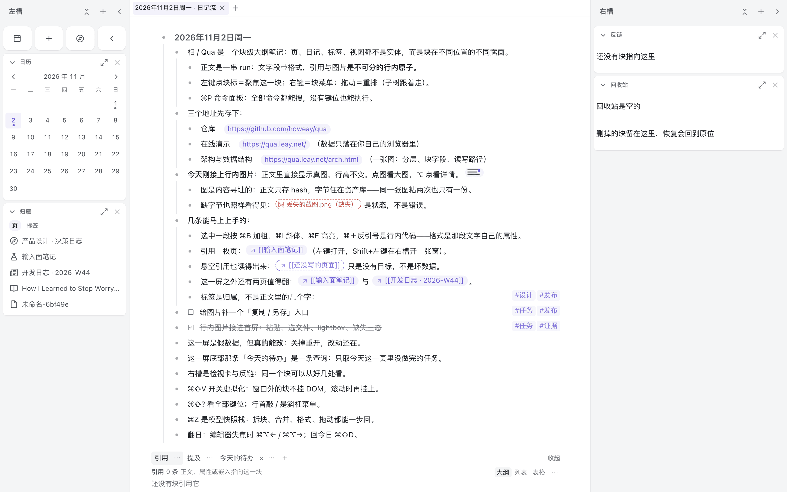
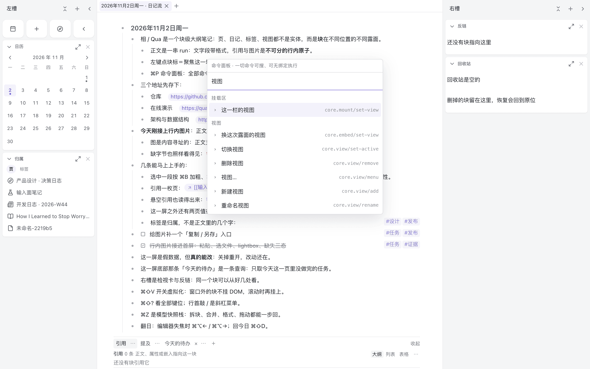
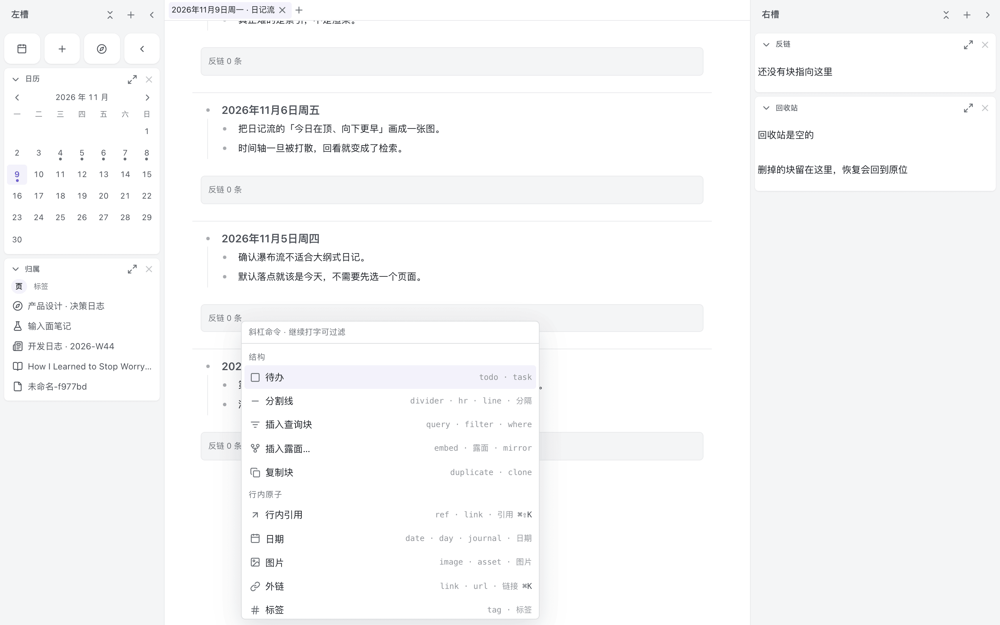
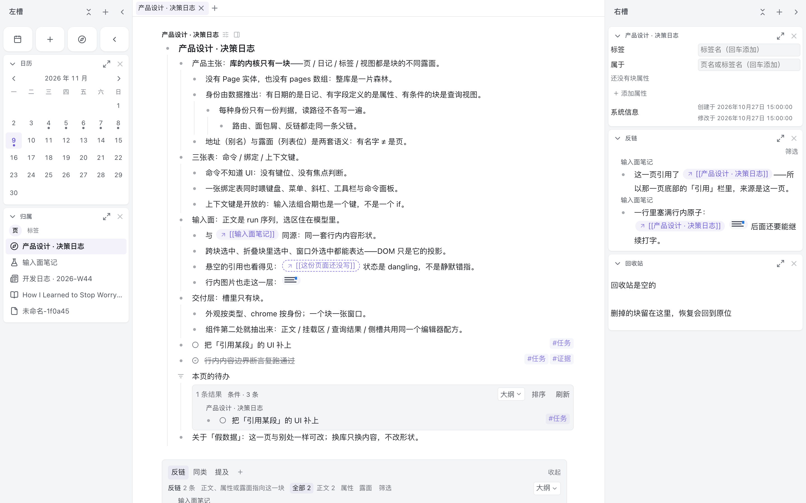
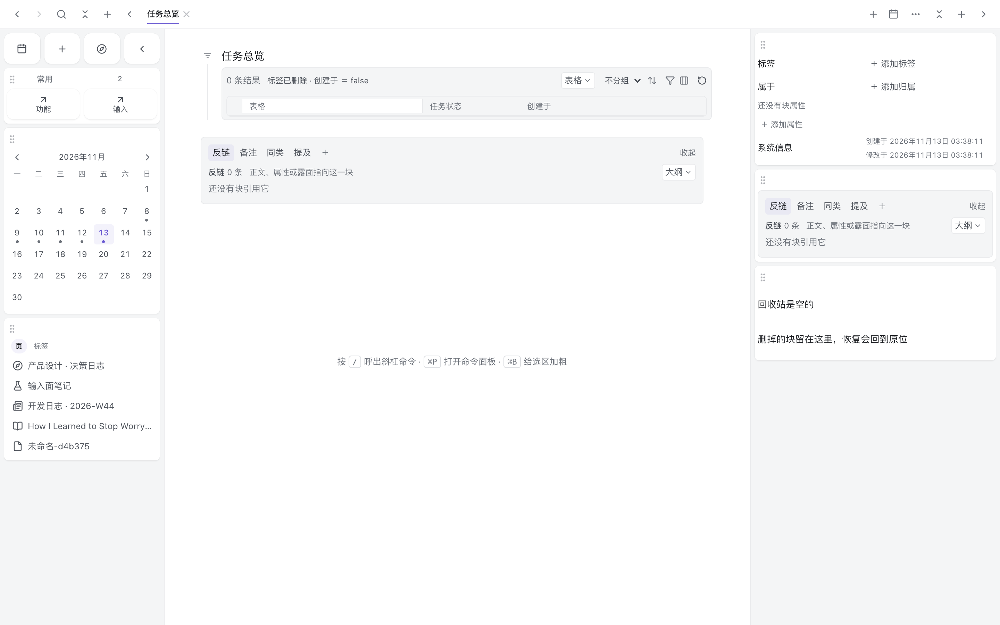
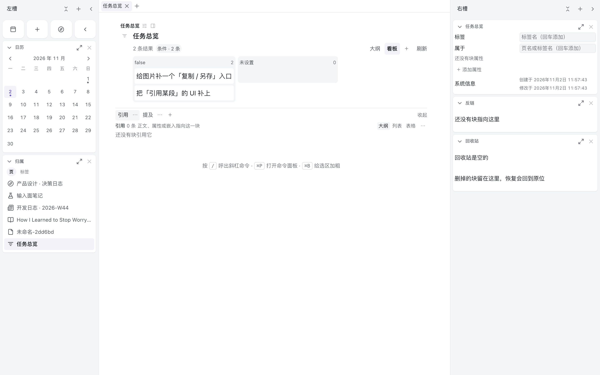
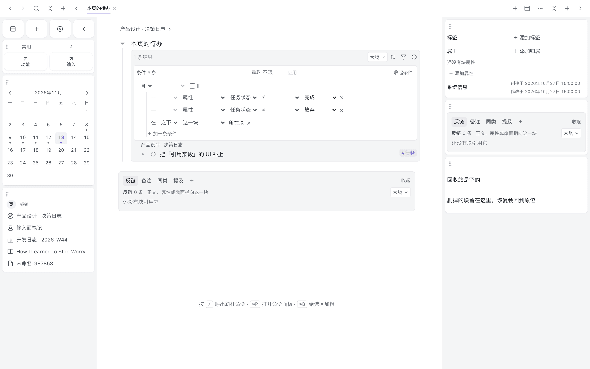
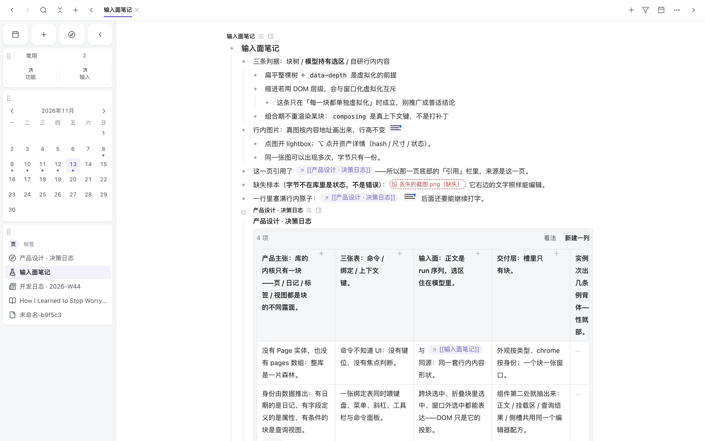
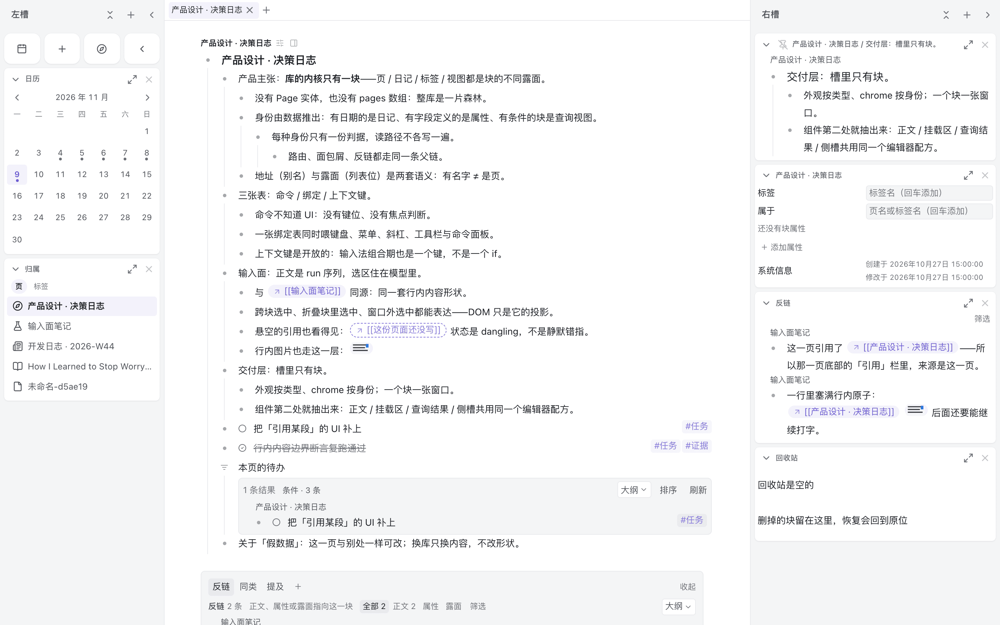
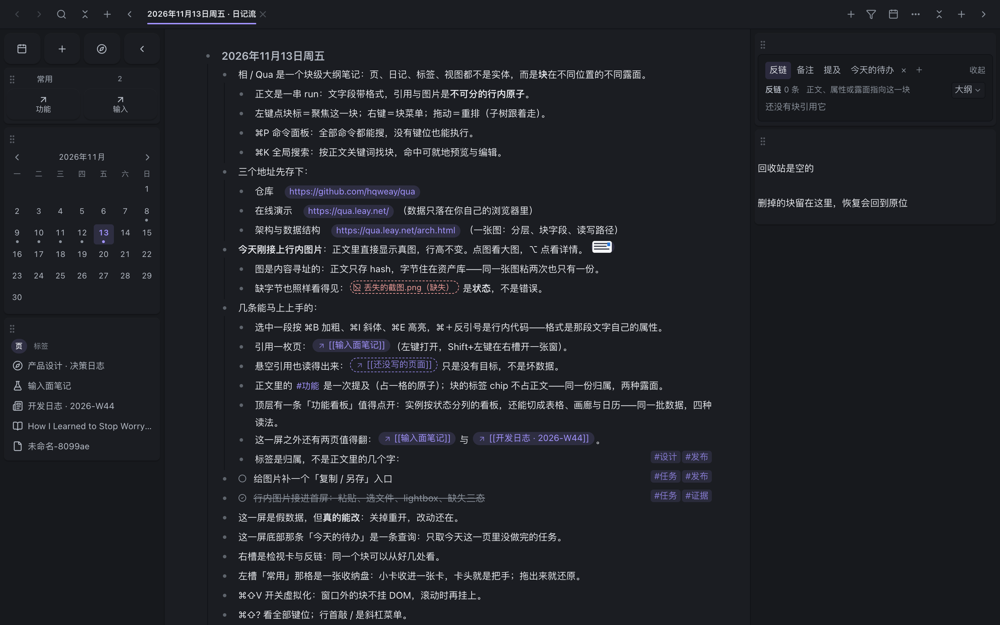

# 相（Qua）

**一个以「块」为唯一原子的块级大纲笔记 · 桌面版。**

页、日记、标签、视图、侧栏——它们都不是独立实体，只是同一批块在不同位置、不同看法下的呈现。
你在屏幕上看见的一切，都能拆成块；每一块，都能换个地方、换种看法，再出现一次。



**[在线演示 → qua.leay.net](https://qua.leay.net/)** · 不用安装，打开就能写。数据只落在你自己的浏览器里。
想先看设计再看产品：**[架构与数据结构 → /arch.html](https://qua.leay.net/arch.html)** ——
一张图讲清分层、块的字段、写/读路径；图上的版本号与门禁基线由部署流水线现算，不是手写的。

> ⚠️ **这是原型，不是 v1。** 允许硬编码假数据，界面文案只有中文。
> 当前阶段唯一不许退化的两样东西：**输入面的形状**（块树 ＋ 块内 run 序列 ＋ 稳定块 id）
> 和**三张表**（命令 / 绑定 / 上下文键）。

---

## 一个主张

> **库里只有一个东西：块。别的东西都是它的打扮。**

| 你以为是实体的 | 它其实是 |
|---|---|
| 页 | `_lists` 里有 `page` 的块；页名是它的主别名，正文是描述 |
| 日记 | 带 `_date` 的块；身份由数据推出，不存标记，全局一天一个 |
| 标签 | 块上的一格分类归属（`props._tags`）；标签本身是 `_lists` 里有 `tag` 的块 |
| 视图 | 对真实树的一次渲染 |
| 侧栏 / 面板 | 一个槽，里面是一列块 |

于是四条判据贯穿全仓：

1. **身份不占位置。** 位置属于内容，名字属于身份。一个块在哪儿、出现在几处，不改变它是谁。
2. **正文是一串 run。** 文本段带格式，引用、图片、链接是不可分的行内原子——不是一堆 HTML。
3. **数据层只回答「是什么」。** 「这次怎么显示」归查询条件或视图配置，不往块上加字段。
4. **交付层：槽里只有块。** `renderBlock(block, ctx)`，外观按类型、chrome 按身份，一个块可以在多处同时被编辑。

完整推导与「别再想一遍」的已否决方案在 [`docs/模型-一切皆块.md`](docs/模型-一切皆块.md) —— **动模型之前先读它。**

---

## 写：一块一块地长出来

正文是一棵可编辑的块树。光标落在哪，`Enter` 就按那个落点建块：块中拆成同级、块尾建子块、
空块深处反缩进。缩进、折叠、拖拽重排都在这棵树里完成，子树跟着走。

一段文字可以自带四种格式（**加粗**、*斜体*、高亮、`行内代码`），格式是那一截文字自己的属性，
随文字走。`[[引用]]`、`#标签`、`@提及`、外链、行内图片都是**原子**：不可再拆，删它们不会伤到邻居。



打字键一个都没绑（未绑定 ⇒ 文本输入）；IME 组合期所有键位自动不命中。
用户能看见的每一句文案都走字典，命令与绑定都是**数据**：加一条命令／改一个键位，不用碰事件分支。



`/` 斜杠菜单、`⌘⇧P` 命令面板、块标右键菜单——三个入口回答三个不同的问题，共享同一张命令表。

---

## 组织：页、日记、标签，都是块

打开任意一块的名字，就是给它加一个**地址**（`props._aliases`，首个是主名，允许 `/` 分段）。
给它勾上「页列表」或「标签列表」，就是给它加**露面**（`props._lists`，可兼位、可空）。

- **日记**：`#` 新建的实例与随手记录落在今天；日记流今日在顶，更早存在的天往下。复盘 3 / 7 天。
- **页**：`⌘⇧N` 新建独立页；`@` 提及页与块（页与块同一张候选表），没有同名页时当场建页并引用。
- **标签**：敲 `#名` 默认只是**提及**，`⌥↵` 才是把这一块**归进去**；标签有层级，查父标签能看到子标签的块。
- **归属**：任何块都能配「属于」，左槽的归属树按页 / 标签两面摊开。拖入＝加一条边，**不是搬家**。



---

## 看：同一个块，八种看法

视图的**成员由条件决定，看法只决定怎么画**。改成另一种看法**不重查**——
条件相同、数据相同，结果就相同。

| 看法 | 一行是什么 |
|---|---|
| **大纲**（缺省） | 缩进树本身 |
| **列表** | 一条记录，没有缩进 |
| **表格（平表）** | 行＝记录，列＝属性 |
| **大纲表格** | 表头＝直接子块，一列＝那个子块的孩子；按列排序只改显示序 |
| **看板** | 按某一列的单值分组；**拖卡＝写那一格的值，不是换父子**；空列与「未设置」都在 |
| **画廊** | 封面＝正文第一张图，没有图也给格子 |
| **日历** | 月网格，今天有描边，没有日期的条目列在下方 |
| **思维导图** | 只接子树，节点上限 500，超了明说 |





### 查：把条件读成一句话

查询条件是一棵**条件树**：一行一条，读成一句话；`全部满足 / 任一满足` ＋ 每一层一个「非」，可嵌套。
算子覆盖 等于 / 不等于 / 包含 / 大于 / 小于 / 有没有值 / 是不是空；
`empty` 与 `not exists` 分开——「未填的任务」和「不是任务」是两件事。

点「应用」才写一次（一轮撤销）。折叠折的是**结果视图**，不是子树；展开 / 收起不重查。



---

## 同一块，两处出现

有三种方式让同一份内容在别处再出现一次，**一处编辑、多处同步**，关闭视图不删块：

- **露面（嵌入 / 镜像）**：把一页或一个块摆进另一页的正文里。空心块标说的是「这一行的身体不是一份独立内容」。
- **侧槽窗口**：拖一个块进左槽或右槽，得到一张钉住的窗口卡，卡里是同一份内容，能直接改。
- **查询**：一个块的条件可以被正文、侧槽、整屏页面同时渲染，各自冻结自己那一份结果。





**侧槽的形状**：一个块一张卡。卡头可以收起、只看这一张、关闭、拖拽排序（含左槽拖到右槽）；
拖内侧边缘调宽，双击手柄恢复默认。关闭只影响视图，不删块。

---

## 属性：一块的数据，写在它自己身上

全局字段定义（`_kind` 推出身份）、平铺 ＋ 来源标注。按 kind 提供
文本 / 数字 / 日期 / 勾选 / 单选 / 引用 / 链接 的编辑面，画在右槽的检视卡上，跟着当前对象走。
另有一段只读的**系统信息**：创建 / 修改时刻是块自己的事实，不是可编辑的数据。

- 高频属性（如任务状态）在块左侧另有一个**快捷入口**：画的是当前值的图标，点它开取值菜单
  （完成型属性则直接翻完成）；面板与行上两处改的是同一个值。
- `select` 的**选项是属性定义块的子块**：改名不改值，删掉只是软删（值保留，恢复后自动回来）。
  每个选项可以带自己的**图标**，并可在选项编辑器里标出哪一个值表示「完成」——
  自定义的「任务」属性因此和内置任务状态走同一套勾选、删除线与查询。
- 勾上「允许多个值」后，一个块可以选多个选项：块左侧依次画每个值的图标（前 3 枚 + `+N`），
  点整串开多选菜单（勾选不关）；查询里 `eq` 表示「包含」。看板/卡片不支持多值分组
  （拖卡写值没有唯一动作），列表/表格按值 fan-out。
- 标签的卡里多一段「标签属性」：列出给成员的属性格，可解除，并有自己的添加入口。
  两个 picker **各按自己的槽去重**——声明过的能给自己加，自己有值的也能声明给成员。

---

## 交互速查

**键盘**

| 键 | 做什么 |
|---|---|
| `Enter` | 按落点建块：块中＝同级拆；块尾＝子块；空块深层＝反缩进 |
| `Backspace` | 块首 ⇒ 合并到前一块；否则原生删除 |
| `Tab` / `Shift+Tab` | 缩进 / 取消缩进 |
| `⌘A` | 全选正文（跨块） |
| `⌘⇧A` | 开始块选区；`⇧↑` / `⇧↓` 扩选，`⌫` 删除，`Esc` 取消 |
| `⌘.` | 折叠 / 展开当前块 |
| `⌘⏎` | 切换待办 |
| `⌘⇧D` | 复制块（含子树）；编辑器失焦时＝回今日 |
| `⌘⇧⌫` | 删除块 |
| `⌘B` `⌘I` `⌘E` `` ⌘` `` | 加粗 / 斜体 / 高亮 / 行内代码 |
| `⌘⇧P` | 命令面板（无绑定也能执行） |
| `⌘P` | 全文搜索（桌面端 SQLite FTS；web 为扫描降级） |
| `/` | 斜杠菜单；`⌘/` 随时打开 |
| `#` | 标签浮层：`↵` 提及 · `⌥↵` 归类到本块 · `⇧↵` 新建今日实例 |
| `@` | 提及页或块；无同名页时 `↵` 当场建页并引用 |
| `⌘⇧K` / `⌘K` | 插入 `[[引用]]` / 外链（只收 `http`、`https`） |
| `⌘⇧N` | 新建页 |
| `⌘⇧L` | 亮 / 暗 / 跟随系统 |
| `⌘Z` / `⇧⌘Z` | 撤销 / 重做（按事务记动过的块，含块结构与行内内容） |
| `⌘[` / `⌘]` | 后退 / 前进（中心槽导航历史，与撤销是两套） |
| `⌘T` · `⇧⌘[` `⇧⌘]` · `⇧⌘W` | 新建 · 切换 · 关闭标签页 |
| `⌘⇧R` / `⌘⌥⇧R` | 复盘最近 3 / 7 天 |
| `⌘⌥←` / `⌘⌥→` | 上一天 / 下一天（日记视图、编辑器失焦时） |
| `⌘⌥1` / `⌘⌥2` | 开关左槽 / 右槽 |
| `⌘⇧?` | 键位表 |

**鼠标**：悬停块左侧出现块标。**左键 ＝ 聚焦/zoom**，**右键 ＝ 块菜单**，拖动 ＝ 重排。
**Shift+左键任何「可打开」的地方**（块标、行、行内引用、反链、面包屑、归属树的一行、日历日期、查询的看板／画廊／列表／表格卡）＝ **在右槽开一个窗口**；`⌘/Ctrl+左键`＝在新 tab 打开。
块前的导轨画的是祖先层级，点某一段就折叠那一层的子块。

**拖拽落点**：落到正文＝移动；落到归属树的一行＝加一条「属于」边；落到侧槽＝在那一槽打开。
落点含义在悬停时就写在提示里。

---

## 架构一眼

```
core ← view ← ui ← app ← host
```

- **`core/`** —— 零 DOM。模型、纯逻辑、命令声明、消息字典。
- **`view/`** —— 编辑器 DOM 契约的产地（块级 DOM、run 渲染与读回、事件）。**不许 import `ui`**。
- **`ui/`** —— 组件（槽、浮层、角标…）。只认 token，不认基础色。
- **`app/`** —— `App` 门面与命令实现。命令只经门面改状态，**不碰 `document`**。
- **`host/`** —— `src/main.ts` 的装配 ＋ `electron/` 的壳。只做 wiring。

结构约束由 `pnpm arch:check` 静态执行（当前 **29 条硬断言**，不是约定）。几条有代表性的：

1. 层级只能单向依赖，`view` 不得 import `ui`；
2. 命令 handler 不得出现 `document`／`window`；
3. 用户可见文案不得是裸中文，一律 `t('id')` 走字典；
4. 组件不得引用基础色 `--c-*`，只能用语义槽 `--ui-*`；
5. 块树遍历只有一个入口（`core/walk.ts` 的 `walkForest`）；
6. 行内内容只有 run 序列一套，旧形状的零件不许复活。

逐条账在 [`docs/ARCH-断言.md`](docs/ARCH-断言.md)。

---

## 数据放在哪

**桌面版（Electron）**：每个库是一个目录，内容真相是目录里的 **`qua.db`**（SQLite）。
块拆成**自己的行**，不是一整份 JSON：

| 表 | 装什么 |
|---|---|
| `Block` | 一行一块：正文（run 序列 JSON）、区间注解、`created`／`modified`、落库编码的 `parent`／`left`、软删时刻 |
| `BlockProperty` | 属性袋，一格一行（有序的字符串列表拆成多行 ＋ `pos`） |
| `BlockAlias` | 地址（有序，首个是主名） |
| `BlockList` | 露面（`page`／`tag`） |
| `meta` | 库级两格（当前对象、落盘时刻）＋ 身份与写序号水位 |

⇒ **一次编辑只写它动过的那几块**，写成本不随库体量增长。
「一个块长成哪几行」只有一份定义（`src/core/storage/db-rows.ts`）；主进程只做通用 SQL。

库目录形状：`library.json`（身份）＋ `qua.db` ＋ `assets/` ＋ `backups/`。

**浏览器（含[在线演示](https://qua.leay.net/)）**：没有库目录，仍是 `localStorage`，
键 **`qua.workspace`** —— 浏览器没有「用户可选目录」的同等语义。

⚠️ **改 `qua.workspace` 这个键名＝所有浏览器端数据静默消失**，所以 `arch-check` 有一条断言把值钉死。

版本号有两个，各判各的：`PRAGMA user_version`（`DB_SCHEMA_VERSION`）判**这份数据能不能读**；
`WORKSPACE_VERSION` 是浏览器那侧的载荷版本。原型**不做旧数据迁移**：口径一变就加版本号，
旧库显式作废、重新 seed，不写兼容分支。

---

## 参与开发

**先读 [`AGENTS.md`](AGENTS.md)** —— 动手前必须知道的工程纪律（AI agent 也会自动加载它）。

```bash
pnpm dev          # vite + electron 一起起；光标已在第一块，直接敲字
pnpm dev:web      # 只起 vite → http://127.0.0.1:5180/
pnpm gate         # ★ 收工门禁（全量）：静态 + 单测 + 构建 + 冒烟 + 布局 + 真 Electron
pnpm gate:queued  # 同 gate，但文件锁串行＋在隔离 worktree 里构建已提交的 HEAD（多人/多任务共用一台机器）
pnpm gate:fast    # 按 git 改动只跑「碰得到的那几支」，并逐条列出跳过了什么
pnpm test:one tests/x.test.ts   # 内环：只跑这几个单测文件（~0.2s）
```

**收工只认外环**：`pnpm gate` 全绿才算做完。当前基线：
arch **29/29** · test:core **901/901** · 浏览器冒烟 **247/247** · dock **26/26** · electron **16/16**。

- 前置：**Node 26.x**（`.node-version` 钉住；旧版会让 rollup 原生模块 dlopen 失败）、pnpm 11.x。
- `gate` 是**编排**出来的，不是一条 `&&` 链：彼此独立的检查按产物依赖分三段、段内并发，
  冒烟用例按序切片同时跑。快的原因**是并发，不是少跑**——断言一条没动。
- `gate:fast` **不是收工门禁**：它按这次改动的路径判面，跳过碰不到的，并逐条打出来；认不出的路径一律按全量。
- 打算动手？先看 [`docs/ROADMAP.md`](docs/ROADMAP.md)；分支与提交见 [`CONTRIBUTING.md`](CONTRIBUTING.md)。

### 已知边界（原型）

- 没有通用备份 / 导出入口；读盘失败时进入**只读演示态**（不覆盖原数据），开发构建的调试菜单里有「备份并重建本地库」。
- `⌘P` 是桌面端 SQLite FTS（contentless 三列：分词／逐字／拼音），索引可全量重建；
  web 宿主没有 SQLite，保持文本扫描并在标题标明降级；`#`／`@` 浮层仍只扫内存里的名字与正文，未接 FTS。
- 没有图谱、没有导入导出。
- 跨块**文本选区**的删除 / 替换还没在模型侧实现（块选区可以整块删除 / 复制）。
- 视图配置还差两截：列的显隐 / 列宽拖动、看板分组列、日历日期列，建视图时会自动挑一个能用的，改要等下一轮。
- 面板里的 local 栏不建块、也不指向块：块上的随块走（`_mounts`），日记面板的在**设备状态**里。要跨设备/共享就写成查询块（内容对象）。
- 行内资产只有图片，且删掉一枚图片 run **不回收字节**（v1 无 GC）。
- 桌面壳未签名公证、没有自动更新。界面文案只有中文。

---

## 文档地图

| 文档 | 给谁看 | 内容 |
|---|---|---|
| `AGENTS.md` | 贡献者 / AI agent | 铁律、门禁、代码纪律速查 |
| `CONTRIBUTING.md` | 贡献者 | 分支、提交、PR、review 口径 |
| `docs/ROADMAP.md` | 想动手的人 | 接下来做什么、按什么顺序、怎么验收 |
| `docs/模型-一切皆块.md` | 改模型的人 | 模型第一性、三条判据、已否决清单 |
| `docs/ARCH-断言.md` | 贡献者 | 架构断言逐条账：能静态查的 / 只能靠约定的 / 等内核的 |
| [`public/arch.html`](public/arch.html) | 所有人 | 一张图的架构与数据结构（部署时填真值 ⇒ 线上版 [/arch.html](https://qua.leay.net/arch.html)） |
| `docs/ELECTRON-备忘.md` | 改壳的人 | 桌面壳踩坑、与 Chrome 的行为差异、真机实测 |
| `TODO.md` | 贡献者 | 已知 bug 与概念澄清（编号、复现步骤、状态） |

---

## 主题与状态

亮 / 暗 / 跟随系统只换 token，**不改 DOM 形状**。三个降级形态（空态 / 稀疏态 / 降级态）都不溢出、不空白。



---

## 许可

[AGPL-3.0](LICENSE) © 2026 hqweay
