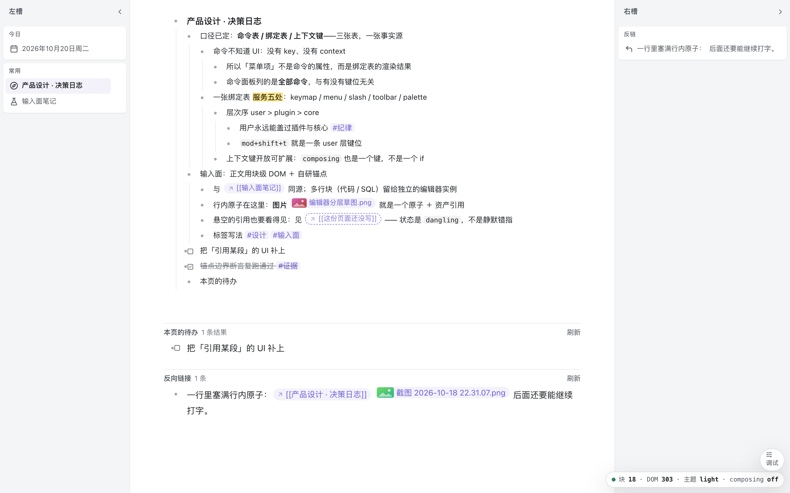

# 相（Qua）

**块级大纲笔记 · 桌面版。** 一个以「**块**」为唯一一等公民的桌面笔记：
页、日记、标签、视图、侧栏，都不是独立实体，而是块在不同位置的不同呈现。



> ⚠️ **这是原型，不是 v1。** 不接数据库、不接内核进程、允许硬编码假数据。
> 当前阶段唯一不许退化的两样东西：**输入面的形状**（块树 ＋ 带 `blockId` 的区间锚点）
> 和**三张表**（命令 / 绑定 / 上下文键）。

## 名字：相 与 Qua

| | 用在哪 | 说明 |
|---|---|---|
| **相** | 显示名 | 应用名、窗口标题、菜单栏、安装后的 App 名。`productName: "相"` |
| **Qua** | 工程名 | 仓库名、包名、命令、文档里指代这个项目。**相是 Qua，Qua 是相**，两个名字指同一个东西 |
| `net.leay.qua` | 标识符 | `appId` / `bundleId`。用全小写 ASCII，**不含中文也不用连字符**——它决定用户数据目录的路径（`~/Library/Application Support/net.leay.qua/`），中文路径在脚本、日志、备份工具里到处是坑 |

起草理由：「相」＝ 看见的那个面（视角即本体）；「Qua」取 *qua*（作为／就其为）——
同一个东西，换个位置就是另一种看法。这是产品的核心主张，不是随手起的名字。

> 命名**不可逆**：改 `appId` 会让所有人的数据目录搬家。真要改，必须配迁移。

---

## 它想验证什么

笔记工具的内核只该有**一块**：块。在此之上有四条判据，代码是围着它们长的。

| 判据 | 在代码里的落点 |
|---|---|
| **输入面形状优先**：正文用自研块级 DOM（不是 contenteditable 套 ProseMirror），锚点带 `blockId`，IME 组合期不重渲染正在组合的块 | `src/view/` · `src/core/annotations.ts` |
| **三张表说了算**：命令（纯语义）、绑定（键位/菜单/斜杠/工具栏/命令面板共用一张）、上下文键（开放键空间，IME `composing` 也是一个键） | `src/core/commands/` · `bindings.ts` · `when.ts` |
| **主进程不含业务逻辑**：壳只做窗口与端口中转；换内核时 renderer 一行不用改 | `electron/main.ts`（只有五件事） |
| **换肤不改 DOM 形状**：主题只换 token，冒烟断言钉死「换肤前后 `data-depth` 序列一致」 | `src/styles/tokens.css` |

「一切皆块」这条模型铁律的完整推导在 [`docs/模型-一切皆块.md`](docs/模型-一切皆块.md)——
**动模型之前先读它**，那里也列了「别再想一遍」的已否决方案。

---

## 快速开始

```bash
git clone <this-repo> && cd qua
pnpm i
pnpm dev          # vite + electron 一起起；光标已在第一块，直接敲字
```

不需要配置任何东西。打开就能写；关掉重开内容还在（数据落在 Electron 的 `localStorage`）。
首次启动且本地无数据时，会载入一份像真实笔记的假数据库。

| 前置 | 版本 | 说明 |
|---|---|---|
| Node | **26.x** | `package.json` 的 `engines` ＋ `.node-version` 都钉住了。旧版会让 rollup 原生模块 dlopen 失败 |
| pnpm | 11.x | `packageManager` 字段钉住 |

只想起浏览器版（不启 Electron）：

```bash
pnpm dev:web      # → http://127.0.0.1:5180/
```

---

## 交互一览

**键盘**

| 键 | 做什么 |
|---|---|
| `Enter` | 按落点建块：块中＝同级拆；块尾＝子块（无子块/折叠时＝同级）；空块深层＝反缩进 |
| `Backspace` | 块首 ⇒ 合并到前一块；否则原生删除 |
| `Tab` / `Shift+Tab` | 缩进 / 取消缩进 |
| `⌘.` | 折叠 / 展开 |
| `⌘⏎` | 切换待办 |
| `⌘⇧D` / `⌘⇧⌫` | 复制块（含子树）/ 删除块 |
| `⌘B` `⌘I` `⌘E` `` ⌘` `` | 加粗 / 斜体 / 高亮 / 行内代码（落成**区间锚点**，不是 run 属性） |
| `⌘P` | 命令面板（列全部命令、可搜、**无绑定也能执行**——这是键盘可达性的兜底） |
| `/` | 斜杠菜单 |
| `⌘⇧K` | 插入 `[[引用]]` |
| `⌘⇧N` | 新建页 |
| `⌘⇧L` | 亮 / 暗 / 跟随系统 切换 |
| `⌘Z` / `⇧⌘Z` | 撤销 / 重做（模型快照栈，含块结构、锚点与行内原子） |
| `⌘[` / `⌘]` | 后退 / 前进（中心槽的导航历史；与撤销是两套） |

打字键一个都没绑（未绑定 ⇒ 文本输入）；IME 组合期所有键位自动不命中。

**鼠标**：悬停块左侧出现块标；**左键 ＝ 聚焦/zoom 到这块**，**右键 ＝ 块菜单**，拖动 ＝ 重排。
**Shift+左键块标 ＝ 在右槽钉住 / 取消钉住**。块前的导轨画的是祖先层级，**点某一段就折叠那一层祖先的子块**（再点展开）。

**侧槽**：把块从正文拖进左槽或右槽 = 钉住（槽里是同一份块，可直接编辑；移除只影响视图，不删块）。
拖左右槽的内侧边缘 = 调整宽度，双击手柄 = 恢复默认。

---

## 现在能做什么 / 还不做什么

**能**：块树编辑 · 区间格式 · 行内引用与图片 · 折叠/拖拽/待办 · 命令面板与斜杠菜单 ·
命令/绑定可以只在数据里加就生效 · 日记流 · 查询视图（冻结结果集 ＋ 刷新按钮 ＋ 原地编辑）·
反链 footer（共享 block store，正文与反链同一块不打架）· 左右槽钉住真实块并原地编辑 ·
槽宽拖拽 · 导航前进/后退 · 亮暗/跟随系统 · 虚拟化（窗口化挂载）·
**标签＝指向边**（成员/反链）· **标签层级**（属于/包含；查父标签能看到子标签的块，
但字段不跟着继承）· **属性区**（全局字段定义、平铺 ＋ 来源标注、摘标签时提示清理）·
**角色开关**（任意块可兼作页/标签：块菜单加/减角色；页不再要求顶层）

**还不能**（原型边界）：

- **持久化是整库序列化**：每次写都是 `JSON.stringify(整库)` 进 localStorage，无事务、无多窗口同步。
- **没有备份/导出入口**：读盘失败时进入只读演示态（不覆盖原数据），但用户暂时没法抢救坏库。
- 没有自研查找（`⌘F`）、没有搜索面板、没有图谱、没有导入导出、没有 i18n。
- 跨块选区能选中，但**跨块删除/替换**还没在模型侧实现。
- 正文里敲 `#` **不会**自动成边（从块菜单的「插入标签」列表选，或直接输入新名字创建；列表显示层级）；
  标签页的成员 footer 可原地编辑，但成员顺序还不能手动调。
- 属性值的编辑面按 kind 给了文本/日期/勾选/单选；`ref` 与 choices 目录还没有专用编辑 UI；
  字段定义块（`schema`）不进任何列表（按角色过滤，未来由字段管理视图接）。
- 引用目标被删时显示插入时的旧名（dangling）；这是少数派状态的兜底，不假装解析成功。
- 桌面壳未签名公证、没有自动更新、深色未在真机验证跟随系统。

每一条的现状与取舍在 [`docs/ARCH-断言.md`](docs/ARCH-断言.md) 与
[`docs/ELECTRON-备忘.md`](docs/ELECTRON-备忘.md) 里都有对应段落。

---

## 架构一眼

```
core ← view ← ui ← app ← host
```

- **`core/`** —— 零 DOM。模型、纯逻辑、命令声明、消息字典。
- **`view/`** —— 编辑器 DOM 契约的产地（块级 DOM、区间锚点、事件）。**不许 import `ui`**。
- **`ui/`** —— 组件（槽、浮层、角标…）。只认 token，不认基础色。
- **`app/`** —— `App` 门面与命令实现。命令只经门面改状态，**不碰 `document`**。
- **`host/`** —— `src/main.ts` 的装配 ＋ `electron/` 的壳。只做 wiring。

四条硬约束由 `pnpm arch-check` 静态执行（不是约定）：

1. 层级只能单向依赖，`view` 不得 import `ui`；
2. 命令 handler 不得出现 `document`／`window`；
3. 用户可见文案不得是裸中文，一律 `t('id')` 走 `core/msg.ts` 字典；
4. 组件不得引用基础色 `--c-*`，只能用语义槽 `--ui-*`。

逐条账（哪条真在跑、哪条只能靠约定、哪条等内核）在 [`docs/ARCH-断言.md`](docs/ARCH-断言.md)。

---

## 命令

```bash
pnpm dev             # 开发：vite + electron（src/** 热更新；electron/*.ts 改动要重跑）
pnpm dev:web         # 只起 vite → http://127.0.0.1:5180/
pnpm gate            # ★ 唯一门禁：typecheck + 单测 + build + arch + 三套冒烟
pnpm arch:check      # 只跑架构静态断言（秒级）
pnpm test:core       # 只跑纯 core 单测（node --test，零依赖）
pnpm check           # 浏览器级冒烟（真 Chrome、真按键、真鼠标）
pnpm check:dock      # 槽与排版形状的布局断言（真量尺寸）
pnpm check:electron  # 真 Electron 冒烟
pnpm shots           # 截图 ⇒ shots/
pnpm build:mac       # 打包 .app（未签名，首次需右键打开）
```

**改完必须 `pnpm gate` 全绿才算收工。** 它由这些组成，缺一项都不算过：

```
typecheck → test:core → build → build:electron → arch:check → check → check:dock → check:electron
```

> `build:electron` 是门禁必需的一环——少了它，`check:electron` 会拿旧的 `main.cjs`
> 跑出**假绿**（真踩过，所以写进门禁而不是写进文档）。

---

## 数据放在哪

`localStorage` 的键是 **`qua.workspace`**（`src/core/workspace.ts`）。
在 Electron 里它落在 `~/Library/Application Support/net.leay.qua/Local Storage/`。

⚠️ **改这个键名＝所有用户的数据静默消失**，所以 `arch-check` 有一条断言把值钉死。
真要改键，必须先改断言、再写迁移。见 [`docs/ARCH-断言.md`](docs/ARCH-断言.md)。

数据目录的整体形状（`kb/` `logs/` `cache/` …）见 [`electron/userdata/README.md`](electron/userdata/README.md)。

---

## 参与开发

**先读 [`AGENTS.md`](AGENTS.md)** —— 那份是动手前必须知道的工程纪律（AI agent 也会自动加载它）。

- 打算动手？先看 [`docs/ROADMAP.md`](docs/ROADMAP.md) —— 现在该做什么、每条怎么算做完。
- 分支与提交：见 [`CONTRIBUTING.md`](CONTRIBUTING.md)。
- 设计上的取舍：`docs/` 下几份是「为什么长这样」，代码注释只写「为什么」，不写「改了什么」。

---

## 文档地图

| 文档 | 给谁看 | 内容 |
|---|---|---|
| `AGENTS.md` | 贡献者 / AI agent | 铁律、门禁、代码纪律速查 |
| `CONTRIBUTING.md` | 贡献者 | 分支、提交、PR、review 口径 |
| `docs/ROADMAP.md` | 想动手的人 | 接下来做什么、按什么顺序、怎么验收 |
| `docs/模型-一切皆块.md` | 改模型的人 | 模型第一性、三条判据、已否决清单 |
| `docs/ARCH-断言.md` | 贡献者 | 架构断言逐条账：能静态查的 / 只能靠约定的 / 等内核的 |
| `docs/ELECTRON-备忘.md` | 改壳的人 | 桌面壳踩坑、与 Chrome 的行为差异、真机实测 |
| `electron/userdata/` | 发布/排障 | 运行时数据目录的形状 |

---

## 许可

[AGPL-3.0](LICENSE) © 2026 hqweay
